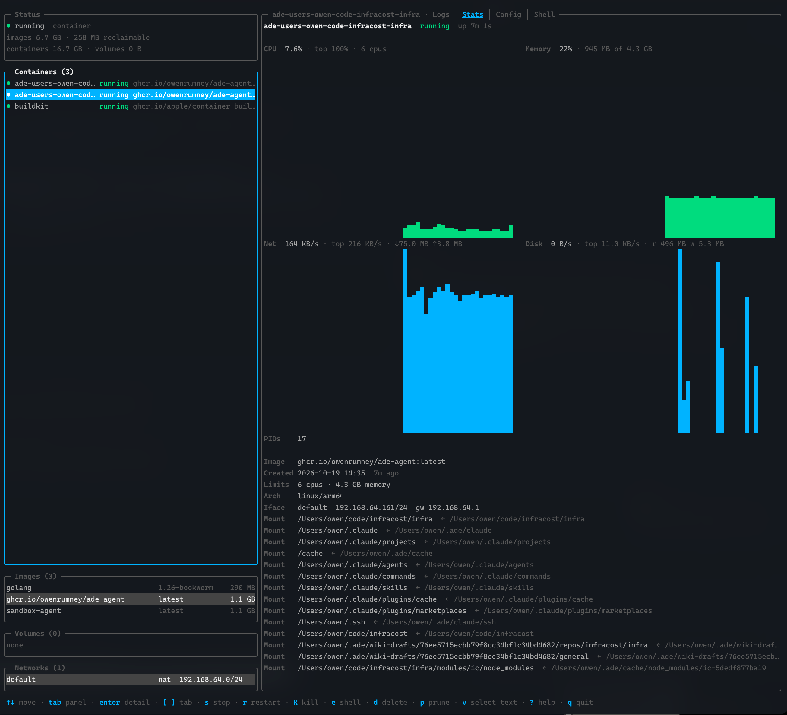

# lazycontainer




## Install

```sh
go install github.com/owenrumney/container-tui/cmd/lazycontainer@latest
```

Requires the `container` CLI on your PATH with its services running (`container system start`).

## Keys

| Key             | Action                                                                                   |
| --------------- | ---------------------------------------------------------------------------------------- |
| `↑`/`k` `↓`/`j` | move selection                                                                           |
| `tab` / `1`–`4` | switch panel (Containers, Images, Volumes, Networks)                                     |
| `[` / `]`       | previous / next detail tab (Logs, Stats, Config)                                         |
| `enter` / `esc` | focus / leave the detail pane for scrolling                                              |
| `s` / `S`       | stop / start container                                                                   |
| `r`             | restart container                                                                        |
| `K`             | kill container                                                                           |
| `e`             | open a shell in the container (bash if present, else sh)                                 |
| `d`             | delete container, image, volume or network (confirms first)                              |
| `p` / `P`       | prune stopped containers, dangling images (`P` = all unused), unused volumes or networks |
| `R`             | refresh now                                                                              |
| `?`             | help                                                                                     |
| `q`             | quit                                                                                     |

Lists refresh every two seconds. Logs follow live. Stats sample every two seconds while the Stats tab is open.

## Development

```sh
go test ./...
go test ./... -tags integration -v   # drives the real container CLI
go run ./cmd/lazycontainer
```
